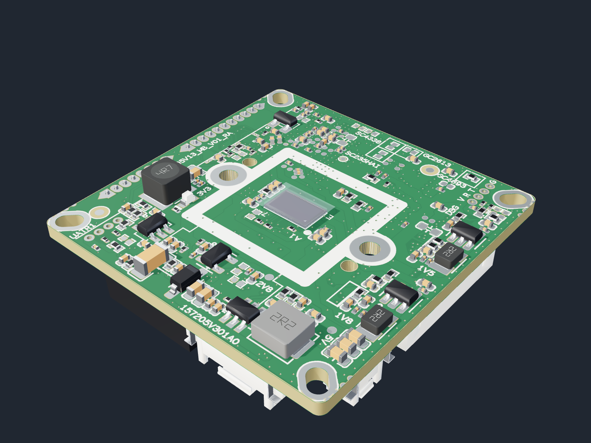
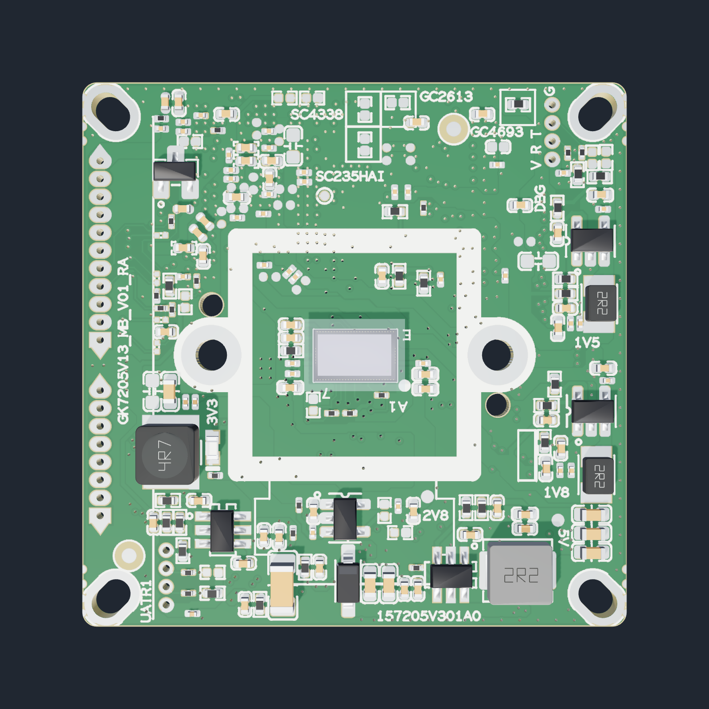
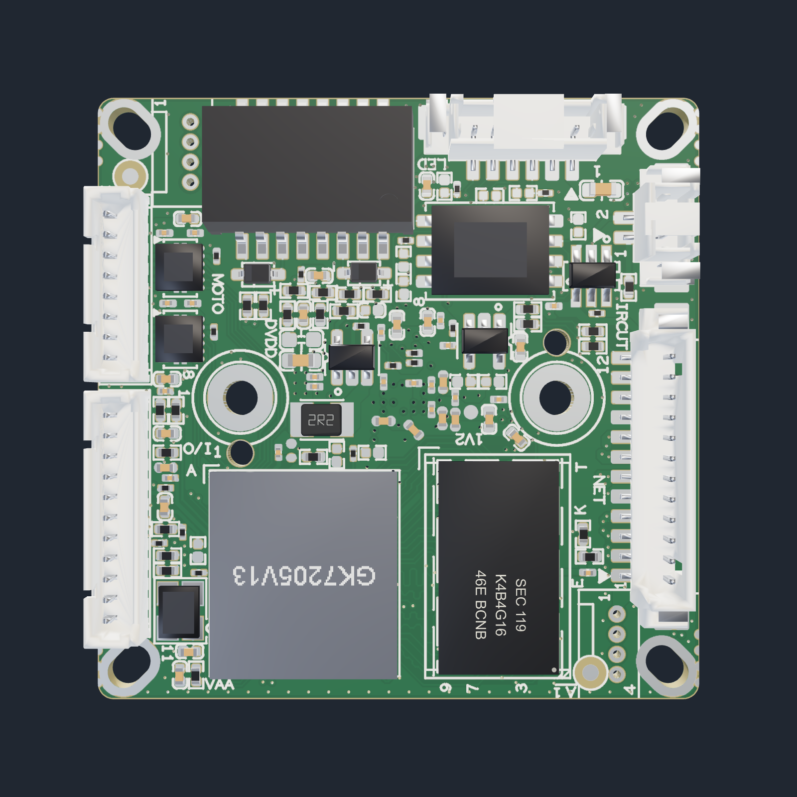
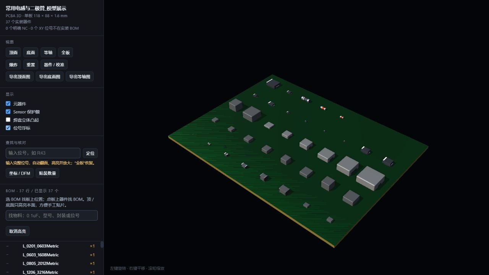

# PCBA3D · 从生产资料生成 PCBA 3D

把 **BOM、贴片坐标和 Gerber/钻孔文件** 转为可交互的 PCBA 三维预览，支持器件定位、手工贴片找料、基础 SMT 几何 DFM、坐标校准及 STEP/STP 导出。

**许可：非商业学习和评估可用；商用必须事先取得作者书面授权。** 详见 [LICENSE](LICENSE)。第三方模型及依赖保留各自许可，本项目的商用限制不替代其原有条款。

本仓库是 Windows 本地工具的公开整理版，当前版本 v1.3.10。提供源码、**64 种可再分发的常规模型**、人工生成的演示输入和 Windows 自动打包流程。原有本地版本中的真实板样例、API 设置、生产工程及未明确再分发许可的模型不包含在本仓库。

v1.3.2 修正了 BOM 自动选择：按表头识别，不需要在文件名中添加 BOM；同一行位号重复时只列出真正重复的位号，补充原行号与用量核对，导入检查区会自动展开异常。

v1.3.3 区分 Excel 行号与 BOM 自带序号：异常提示和导入核对表同时显示源文件行、BOM 序号及位号单元格地址，避免把“Excel 第 46 行”误认为“BOM 序号 46”。

v1.3.4 合并板框与 ROU 中重复的内孔轮廓，并将板体网格计算放入后台 Worker，避免预览卡死；板芯与两面阻焊复用同一份网格，计算异常或超时会显示具体提示。

v1.3.5 增加图形模型选择器：按生产资料的完整封装名选择目标，显示位号、物料说明、模型三维预览和尺寸，再确认绑定。STEP 导入自动命名，支持仅保存到库；文件或变换参数变化后必须重新预览，避免保存旧草稿。同名模型不会覆盖已有模型，单项绑定保留其他映射。

常规阻容封装支持等价别名，例如 `SR0201 = R0201 = 0201R`、`SR0402 = R0402 = 0402R`；电容对应 `SC0201 = C0201 = 0201C` 等。用户保存的映射优先。`SC0402-BGA` 已明确加入 `C0402` / `C_0402` 电容模型别名；其他未列明的特殊后缀不会自动套用普通型号。

v1.3.6 将校准 / DFM 工具停靠在画布旁，打开后自动调整画布尺寸，避免遮挡器件；窄窗口在 BOM 与校准工具之间切换，左栏整体支持滚动，低高度窗口也能访问完整 BOM。收起工具保留选择和未保存调整。

v1.3.7 增加“从焊盘生成 BGA”：从当前工程识别实际球位，保留缺球和混合间距；从 BOM 描述提取可编辑型号标记，预览后保存到本机模型库并绑定封装。模型标记写入 STEP；本体尺寸、球径及高度为估算，A1 需人工确认。

v1.3.8 增加“应用绑定并刷新 3D”：保存模型绑定后直接更新当前工程，保留板层与已保存校准；BGA 页面刷新后返回整板并定位器件。未保存校准会阻止刷新，更新前自动备份；模型改变后需重新导出 STEP 和修正坐标。

v1.3.9 将第一脚 / BGA A1 方向单独展示，提供与器件顶视一致的板面丝印参考；人工确认后绘制圆点或三角，标识同步进入 STEP。校准区增加明确的“保存模型校准绑定”，记住封装、模型和局部偏移 / 角度修正，后续按各器件自身的 XY、旋转角及面别复用。

v1.3.10 增加 PCB 阻焊颜色选择：绿色、红色、黄色、蓝色、白色与哑黑色，切换即预览并自动保存到当前工程。白色、黄色板使用深色丝印，焊盘金属和裸露基材保持原色；导出图片跟随当前预览，STEP 重新导出后同步板色。已有工程点击“应用绑定并刷新 3D”升级界面。

## PCBA 效果预览

以下三张为作者提供的实际工程效果图，展示同一块 PCBA 的传感器面、连接器面和立体视图。图片仅作效果展示，对应生产资料和专用模型未随仓库提供。



| 传感器面 | 连接器面 |
|---|---|
|  |  |

## 能做什么

| 用途 | 功能 |
|---|---|
| 生成 PCBA 3D | 读取原生产资料；板框、板厚、焊盘、阻焊、丝印、钻孔与器件组合预览 |
| 预览与找位号 | 顶面 / 底面 / 等轴、旋转缩放、输入位号自动翻面并高亮 |
| 手工贴片辅助 | 搜索 `0.1uF` 等物料；选 BOM 高亮 PCB，点 PCB 反查 BOM；按面摆料 |
| 校准器件 | 位置和旋转修正、可调粗调 / 微调、引脚吸附焊膏焊盘或阻焊开窗中心 |
| 复用模型 | 封装映射、手动导入 STEP/STP、保存本机模型与封装校准规则 |
| 坐标与基础 DFM | 导出已保存的修正坐标，检查同面本体包围盒重叠、越板框、中心偏移与待处理项 |
| 机械协作 | 导出毫米制、带颜色的 STEP 装配；已有原生 STEP 模型优先复用 |
| 可选 AI | 自行配置 API，提取规格书文本、生成简单参数草稿或查询模型来源 |

基础生成、预览、校准和本地模型匹配**无需联网，也不需要 AI**。AI 默认关闭，只有主动测试、生成或检索时才访问配置的端点。AI 草稿是几何近似，不能替代规格书及原厂模型。



图中是人工排列的模型展示板，不是真实生产板。

## 快速开始

### Windows EXE

到 [Releases](https://github.com/mdc1985221/Create-PCBA-3D-Model/releases) 查看已发布的 Windows 包；若暂未出现二进制包，可按下文运行源码，或在 Actions 手动运行 Windows Build。只有构建及自检成功后才会提供构建产物。

解压完整包后运行 `PCBA3D.exe`。程序只在 `127.0.0.1` 启动本地服务，并打开浏览器界面。首次启动需要解压 CAD 运行时，可能较慢。使用结束后点击“退出工具”。重复启动可能使用不同端口，请使用当前程序自动打开的页面。

### 从源码运行

推荐 Windows 10/11 64 位、Python **3.13** 64 位；目前未验证其他操作系统的完整流程。

```powershell
git clone https://github.com/mdc1985221/Create-PCBA-3D-Model.git
cd Create-PCBA-3D-Model
py -3.13 -m venv .venv
.\.venv\Scripts\python.exe -m pip install -r requirements.txt
.\.venv\Scripts\python.exe src/app.py
```

无需安装 Node.js 或配置前端构建。浏览器所用 Three.js 随仓库提供。

```powershell
# 检查 CAD 内核、资源、HTTP、端口和会话保护
.\.venv\Scripts\python.exe src/app.py --self-test
# 不自动打开浏览器，指定本地端口
.\.venv\Scripts\python.exe src/app.py --no-browser --port 8234
# 用完全合成资料验收预览、STEP 与坐标导出
.\.venv\Scripts\python.exe scripts/verify_public.py
```

## 使用流程

1. 导入制板 Gerber/Excellon，以及生产 BOM 和 XY。支持文件、文件夹和 ZIP；常见表格支持 XLSX、真实 XLS、CSV/TSV，另支持 Allegro 原始坐标文本。无需统一套模板，但仍需确认识别到的列、单位和面别。
2. 选择正确的 XY、BOM，核对板厚及封装映射。默认尝试识别闭合单板轮廓与原点；无法唯一识别时根据提示指定板框层，或手动设置规则板宽高、原点和圆角。
3. 先生成预览。缺模型时可先预览已匹配器件，缺失项列入待处理清单；补齐后再生成完整结果。
4. 查找位号或选择 BOM 找器件。切换顶 / 底面时只显示本面器件，保留所选物料；点击板上器件会定位对应 BOM 行。
5. 如需修正位置，在“器件 / 校准”中调整偏移、旋转、贴板高度，或引脚吸附。**保存本器件**后再导出；保存为封装规则会影响后续生成。
6. 核对“坐标 / DFM”，选择输出原点和角度约定，导出修正坐标；机械装配需要时再导出 STEP。

[完整操作说明](docs/USER_GUIDE.md) · [合成演示资料](examples/synthetic/README.md) · [模型库与第三方许可](THIRD_PARTY_NOTICES.md)

## 模型与 EXE 如何关联

```text
PCBA3D.exe                      # 源码运行时为 src/app.py
aliases.json                    # 随包提供的常规封装映射；后续可在工具中保存
用户模型库/
  models.json                   # 外观、材质、安装类型、来源与 STEP 路径
  models/user/*.step             # 原生几何实体
  来源与许可/                    # 第三方版权、许可及来源清单
工程/                            # 运行后生成，各工程独立保存
模型草稿/                        # 手动导入的暂存模型
```

EXE 自带基础资源；启动后还读取旁边的用户模型库与 `aliases.json`。**备份或换电脑请复制整个程序包，不能只复制 EXE。** 增加模型通常无需重打包；保存绑定后，在当前工程点击“应用绑定并刷新 3D”即可更新。已有工程保留原模型快照，直到主动应用新绑定。

公开库含常规阻容、SOT-23 系列、片式电感、SWPA/MWSA 功率电感、SOD/SMA/SMB/SMC/MELF 二极管及部分晶体。完整清单见 [model-inventory.json](docs/model-inventory.json)。按尺寸和厂商系列匹配；同样的电感值、相近的封装名字都不代表机械尺寸相同。未包含的连接器和专用芯片可自行取得有权使用的 STEP 后导入。

## 坐标和 DFM 的边界

- 导出默认使用**模型本体包围盒中心**，不是自动确定的吸嘴拾取点。应核对实际模型尺寸、中心和原点。
- 单位为 mm；可选择源资料原点或板框原点。底面 XY 不擅自镜像；角度可选择板顶视或器件所在面视角。贴片机的封装零度、底面约定和吸取点仍需人工核对。
- 当前 DFM 是基础几何辅助检查，不覆盖完整焊盘、钢网、极性、电气、热、工艺及设备规则。自动焊盘方向匹配也不能判定极性正确。
- 缺模型、缺坐标或中心待确认会进入待处理清单。部分预览 / 部分坐标不代表整板完整装配数据。
- Gerber/Excellon 支持常用子集；复杂阵列、变换、负片及不支持的指令会提示处理。STEP 和网页渲染的光照、透明材质、板面外观可能不同。

## 源码目录

```text
src/                  本地 HTTP 服务、导入、模型、校准、坐标、STEP、可选 API
ui/                   主界面与导入/模型操作
assets/viewer.html    3D 预览与 BOM、校准、DFM 交互
assets/library/       19 种基础 KiCad 模型与原始 WRL
assets/vendor/        Three.js 本地资源
用户模型库/           45 种补充 KiCad STEP 模型（阻容、电感、二极管）
examples/synthetic/   完全合成的 BOM / XY / Gerber 输入
docs/                 操作说明、公开模型清单与验证说明
scripts/              公开包自检及发布打包
.github/workflows/    Windows CI、EXE 构建与 tag 发布
```

## 打包 Windows EXE

```powershell
.\.venv\Scripts\python.exe -m pip install -r requirements-build.txt
.\.venv\Scripts\python.exe build_exe.py --work-dir _work/exe_build --dist-dir dist
.\.venv\Scripts\python.exe scripts/package_release.py --dist dist
```

打包会生成机器相关的 `.spec`，不应把它当作可移植配置提交。原生 CAD 库需要较多构建、解压空间；成品体积以实际构建为准。当前程序未做代码签名。

仓库 Actions 会验证合成资料并构建 EXE。可从 Actions 下载成功运行的产物；维护者推送 `v*` 标签时，构建成功后上传完整 ZIP 与 SHA256 到 GitHub Releases。完整包不包含真实生产资料和 API 密钥。

## 授权、问题反馈与贡献

商业生产、企业营利业务内部使用、有偿建模/DFM 服务、产品集成或销售分发，需要**提前取得书面商用授权**。请通过 [商用授权联系](https://github.com/mdc1985221/Create-PCBA-3D-Model/issues/new?template=commercial-authorization.md) 联系作者；具体条件另行约定。本项目是“源码可见、非商业许可”，并非 OSI 意义的开源许可证。

问题反馈请说明版本、输入格式、期待结果和实际结果；优先提供脱敏的最小例子。**不要上传真实 API 密钥、客户 BOM、完整生产资料或无权分享的模型。** 第三方资源按原许可执行，详见 [THIRD_PARTY_NOTICES.md](THIRD_PARTY_NOTICES.md)。
